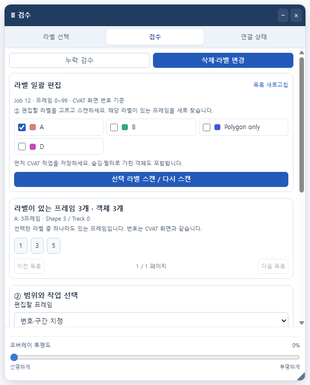
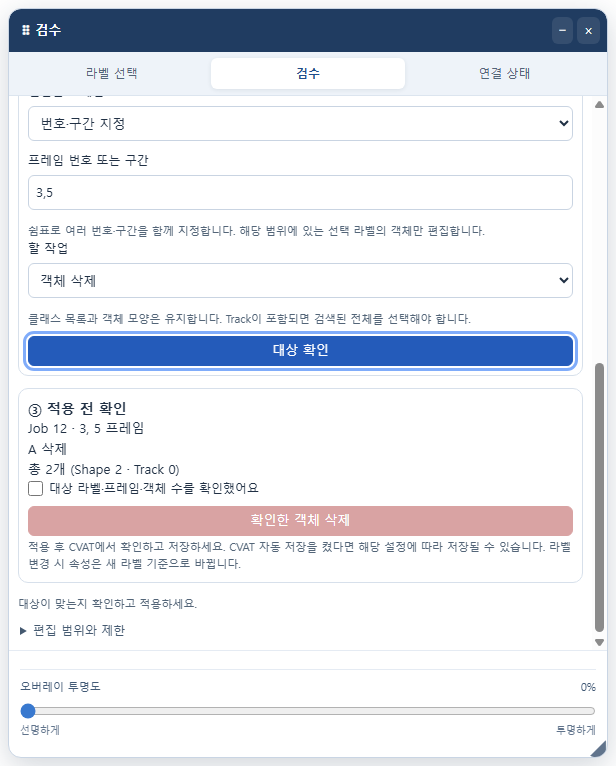

# 2.7.0 검수 통합 삭제·라벨 변경 검증

## 구현한 흐름

팝업과 작업 오버레이의 **검수 → 삭제·라벨 변경**에서 사용합니다.

1. CVAT의 작업을 저장하고 대상 라벨을 선택합니다. 검수의 필수 라벨 선택과 분리되어 있습니다.
2. 객체 삭제 / 다른 라벨로 변경을 선택합니다.
3. `3, 7, 20~40`처럼 번호·구간을 입력하거나 현재 Job 전체를 선택합니다. CVAT 번호를 그대로 사용하고 양 끝을 포함합니다.
4. 대상 확인에서 Job·라벨·프레임·Shape/Track 개수를 확인하고 확인란을 체크한 뒤 적용합니다.
5. CVAT에서 결과를 확인하고 저장합니다. 저장 후 다시 검수합니다.

누락 결과의 현재 필터에 포함된 번호·구간을 편집 화면으로 가져오는 버튼도 추가했습니다. 편집할 라벨은 별도로 고릅니다. 적용을 시작하면 기존 검수 결과를 지우므로 적용 중 팝업을 닫아도 이전 보고서가 남지 않습니다. 실행 중 검수 하위 화면 전환은 막습니다.

## 처리 방식과 경계

- 현재 Job의 CVAT 객체 `ObjectState.delete(frame, false)` / `label` + `save()`를 사용합니다. 클래스 목록은 지우지 않습니다. CVAT 변경 이력에 객체별로 기록됩니다.
- 삭제·수정을 위한 REST 요청과 저장 버튼 호출은 추가하지 않습니다. CVAT의 자동 저장이 켜져 있으면 해당 설정은 계속 적용됩니다.
- 작업 경로·Job/Task ID·2D Standard 화면·그리기/재생/저장 상태·미저장 변경 여부를 검사합니다. 다른 Job으로 바뀌거나 내부 연결을 확인하지 못하면 중단합니다.
- 현재 Job 라벨 ID를 기준으로 대상을 고릅니다. 숨김·필터 객체도 포함합니다. 번호/구간은 최대 200개를 합쳐 중복 처리하지 않습니다.
- Shape는 지정 번호·구간과 전체 Job을 지원합니다. 선택 라벨에 Track이 하나라도 있으면 구간 지정은 차단하며 전체 Job에서만 처리합니다. Tag는 제외하고 Skeleton·잠금·보호 객체는 중단 사유로 안내합니다.
- 저장된 객체 ID와 네이티브 편집 객체가 일치해야 합니다. 확인 정보는 현재 페이지 메모리에 최대 5분 유지합니다. 데이터·라벨 정의·잠금 상태를 적용 직전 다시 확인합니다.
- 적용 중 현재 CVAT 페이지 입력을 잠시 막습니다. 동시 요청은 거부하고 확인 토큰은 한 번만 사용합니다. 적용 후 객체 수·ID·라벨·모양 및 대상 밖 데이터를 확인합니다.
- 라벨 변경 시 속성과 source는 CVAT의 기존 규칙을 따릅니다. 그 외 구조가 달라지거나 기대한 라벨이 반영되지 않으면 완료로 표시하지 않습니다.
- 네이티브 호출 중간의 오류는 일부가 적용됐을 수 있습니다. 자동 복원은 수행하지 않으며 결과와 CVAT 되돌리기를 안내합니다. 여러 객체는 실행 취소가 여러 번 필요할 수 있습니다.
- 최대 20,000개 객체·조회 프레임, 직렬화 문자열 32 × 1024 × 1024자로 제한합니다. 이미지 API·제3자 서버·새 권한·영구 주석 사본은 추가하지 않습니다.

기준으로 확인한 CVAT 공식 소스: [ObjectState](https://github.com/cvat-ai/cvat/blob/develop/cvat-core/src/object-state.ts), [세션 구현](https://github.com/cvat-ai/cvat/blob/develop/cvat-core/src/session-implementation.ts), [주석 화면 액션](https://github.com/cvat-ai/cvat/blob/develop/cvat-ui/src/actions/annotation-actions.ts), [리듀서](https://github.com/cvat-ai/cvat/blob/develop/cvat-ui/src/reducers/annotation-reducer.ts). 내부 API와 `FETCH_ANNOTATIONS_SUCCESS`에 의존하므로 설치본 호환성은 별도 확인이 필요합니다.

## 테스트 결과

| 검사 | 통과 |
| --- | ---: |
| 기존 DOM·단축키·팝업·오버레이 | 478 |
| 라벨 로직 | 12 |
| 연결 상태 로직 | 48 |
| 검수 로직·API 오류 | 48 |
| 새 일괄 편집 로직 | 40 |
| 실제 MV3 팝업·오버레이 일괄 편집 | 10 |
| 기존 Chrome 검수·작업 오버레이 | 30 |
| 확장 재로드 후 라벨·검수·연결 화면 정리 | 3 |
| MAIN·ISOLATED 실행 영역 | 17 |
| 실제 Chrome 연결 상태 API | 19 |
| 릴리스 실패·재실행·패키징 | 39 |
| **합계** | **744** |

실패 0개. 새 편집 검사는 구간 병합, 다른 라벨·프레임 보존, 마스크·폴리곤 형식 호환성, Track 중복 방지, 잘못된 입력, 저장·잠금·보호 상태, 확인 후 데이터 변경, 알 수 없는 Job·액션·토큰, 동시 요청, 중간 실패, native 성공 응답의 실제 결과 불일치, 팝업 종료 중 적용을 포함합니다. 오버레이 입력에는 실제 Chrome 입력 이벤트를 사용했습니다. 패치노트와 생성한 공용 화면의 일치도 검사했습니다.

모든 브라우저 검사는 별도 Chrome 프로필과 localhost 합성 CVAT를 사용했습니다. 회사 서버·실제 라벨링·개인 브라우저 프로필에는 접근하지 않았습니다. CVAT 객체 API와 리듀서는 합성 모델이므로 실제 배포된 CVAT의 전체 저장·되돌리기·서버 재접속까지 확인한 결과는 아닙니다. Mac 검사는 Windows Chrome에서 플랫폼 메타데이터·입력만 모의한 결과입니다.

## 예시 화면

실제 확장 코드를 별도 Chrome에서 띄우고 예시 라벨로 캡처했습니다.

## 로컬 적용

1. CVAT 작업을 저장합니다.
2. `chrome://extensions`에서 `C:\git\cvat_shortcut\extension`을 사용하는 로컬 확장을 새로고침합니다.
3. CVAT도 새로고침한 뒤 확장을 켭니다. 팝업 **2.7.0**을 확인합니다.
4. 검수 → 삭제·라벨 변경으로 들어갑니다. 처음에는 작은 구간에서 대상 확인과 결과를 확인하세요.

소스: `C:\git\cvat_shortcut\extension`

ZIP: [cvat-sidebar-shortcuts-2.7.0-ko.zip](../releases/2.7.0/cvat-sidebar-shortcuts-2.7.0-ko.zip)

37개 런타임 파일이 소스와 바이트 단위로 일치하고 ZIP 무결성 검사가 통과했습니다. SHA-256: `d7054ab395cb77ef468764492455cc89d5a234a48ebb99bf79a738b15d1efc23`.

[파일별 해시](../releases/2.7.0/build-audit.json) · [검증 결과](../releases/2.7.0/validation-2.7.0.json)

이번 작업에서는 GitHub 푸시·웹스토어 제출을 실행하지 않았습니다.
