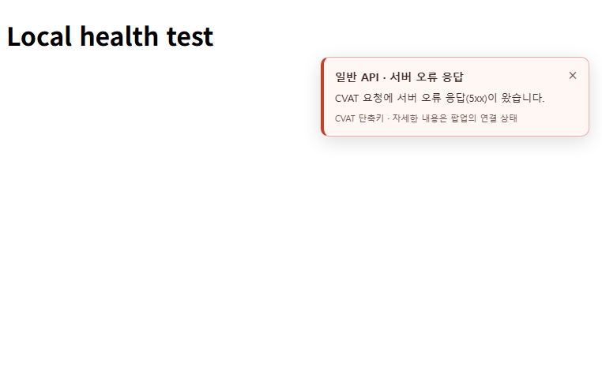
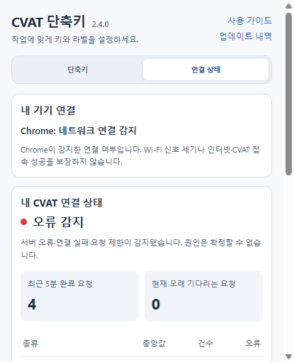

# 2.3.1 연결 오류 알림 검증

로컬 확장프로그램에 오류 알림과 Chrome 연결 상태 표시를 추가했다. 팀 공유, Windows 보조 프로그램, Wi-Fi 신호 세기 측정은 포함하지 않는다.

## 사용 동작

- 연결 상태 측정이 켜진 CVAT Job에서 서버 오류, 요청 연결 실패, 요청 제한, 로그인·권한 오류를 감지하면 화면 오른쪽 위에 알림을 표시한다.
- 알림은 8초 뒤 사라지고 닫기 버튼으로 즉시 닫을 수 있다. 같은 종류는 1분에 한 번만 표시하며, 서로 다른 종류도 4초 안에 연속 표시하지 않는다.
- 팝업의 **연결 상태 → 오류·연결 끊김 알림**에서 알림을 끌 수 있다. 알림을 꺼도 요청 측정은 계속된다.
- Chrome이 오프라인 전환을 알리면 팝업이 닫힌 상태에서도 연결 끊김 알림을 표시한다. 온라인 전환 시 남아 있는 연결 끊김 알림은 즉시 제거한다.
- 팝업의 **내 기기 연결**에는 Chrome이 감지한 연결 여부를 표시한다. 연결됨 표시는 인터넷이나 CVAT 접속 성공을 보장하지 않는다.
- 정상 작업 중에는 상태창을 화면에 계속 띄우지 않는다. 자세한 측정 결과는 기존 팝업에서 확인한다.

## 검증 결과

총 **582개 통과, 실패 0개**.

| 검사 | 통과 |
| --- | ---: |
| 합성 브라우저 회귀 검사 | 457 |
| 연결 측정 코어·워커 검사 | 45 |
| 실제 Chrome 확장 API 통합 검사 | 19 |
| 라벨 로직 검사 | 12 |
| Chrome 실행 환경·오버레이 검사 | 15 |
| 릴리스 패키징·실패 처리 검사 | 34 |

실제 Chrome의 별도 테스트 프로필과 localhost Job 화면에서 다음 동작을 확인했다.

- 실제 저장·AI·HTTP 503 요청의 집계와 오른쪽 위 알림 위치
- 팝업이 닫힌 상태의 측정, 워커 재시작, 페이지 새로고침과 Job 이동
- 별도 CVAT 요청 없이 Chrome 오프라인 이벤트로 알림 표시 및 재연결 시 제거
- 닫기 버튼의 키 입력이 문서의 도구 단축키로 전달되지 않음
- 반복 오류 알림 제한, 알림을 꺼도 측정 유지, 8초 자동 닫기
- 측정 중지 시 알림과 연결 이벤트 수신 제거
- 현재 Job·메인 프레임·세션이 일치하는 연결 이벤트만 처리
- 권한 부여 전 시작 및 페이지 알림 주입 실패 시 기존 측정 유지

변경된 JavaScript 구문 검사, 업데이트 내역 일치 검사, 패키지 재현성 및 파일 무결성 검사도 통과했다. 배포 ZIP에는 승인된 실행 파일 **28개**만 포함한다.

## 데이터와 검증 범위

추가 ping·fetch 등의 진단 요청을 보내지 않는다. 기존 요청의 분류·소요 시간·결과와 브라우저 연결 이벤트만 사용한다. 요청 본문, 응답 본문, 인증정보, Wi-Fi 이름·신호 세기는 수집하지 않는다. 측정값을 외부 서버로 전송하지 않는다.

오프라인 검사는 Chrome 개발자 프로토콜로 연결 상태를 전환했다. 실제 Wi-Fi 어댑터를 끄거나 회사 CVAT 서버에 접속한 검사는 아니다. 사이트 권한 허용 창은 자동 조작하지 않았으며, 실제 사용자 프로필에 설치된 확장프로그램의 갱신 여부는 확인하지 않았다. 전체 Chrome 재시작은 새 워커와 저장된 설정으로 모델링했고, 실제 페이지 새로고침과 Job 이동은 별도로 확인했다.

이 보고서는 로컬 구현·검증 결과다. GitHub 푸시 또는 Chrome 웹스토어 배포 완료를 의미하지 않는다.

## 확인 화면

다음은 회사 화면이 아닌 localhost 테스트 화면이다.

## 로컬 적용

압축 해제된 확장프로그램 폴더는 `C:\git\cvat_shortcut\extension`이다. `chrome://extensions`에서 해당 확장프로그램을 새로고침하고, CVAT 작업을 저장한 뒤 페이지를 새로고침한다. 팝업의 **연결 상태**에서 측정이 켜져 있는지 확인한다. 자동 측정을 이미 켜 두었다면 같은 사이트의 Job에서 다시 시작된다.

패키지: `releases/2.3.1/cvat-sidebar-shortcuts-2.3.1-ko.zip`
