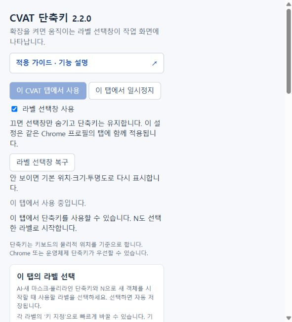
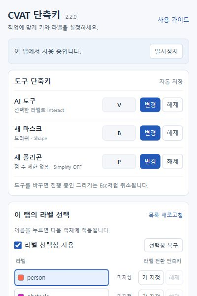
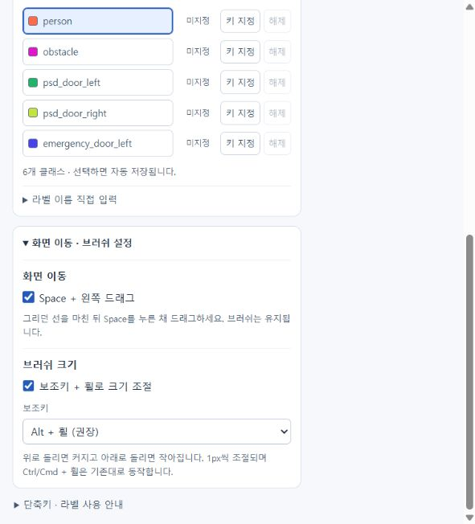
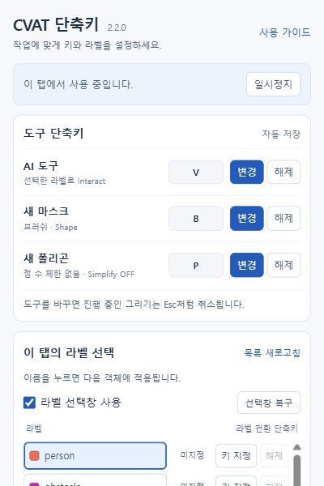

# 팝업 UI 정리 — 2.2.0

실제 확장 popup.html / popup.css / popup.js를 로컬 예시 데이터와 함께 렌더링해 확인했습니다. 사용자 Chrome 설정이나 회사 CVAT 페이지는 사용하지 않았습니다.

1. **도구 단축키 찾기 — 개선 확인.** 이전에는 안내문과 라벨 설명 아래로 AI·폴리라인·브러쉬가 떨어져 있었습니다. 최종 도구는 AI·새 마스크·폴리곤입니다. 세 도구를 첫 카드에 모아 이름 / 현재 키 / 변경·해제를 같은 열로 정렬했습니다. AI 단축키 지정 후 V 저장도 브라우저 입력으로 확인했습니다.
2. **라벨 선택과 키 지정 — 정렬 확인.** 색상·이름·단축키·변경 버튼이 같은 행에 표시됩니다. 6개 예시 클래스, 긴 이름, 선택 상태를 확인했습니다. 목록은 높이를 제한해 스크롤하며 사용 안내와 직접 입력은 접었습니다.
3. **추가 설정 — 펼침 확인.** 화면 이동·브러쉬 설정을 펼치면 Space와 보조키 옵션을 확인할 수 있습니다. 설정 저장 성공 안내는 3.5초 뒤 사라지고 오류 안내는 유지됩니다.

사용 중에는 활성화 버튼 대신 일시정지 하나만 보입니다. 가이드는 제목 옆, 오버레이 표시와 복구는 라벨 영역에 배치했습니다. 동일하게 보이던 도구별 지정·해제 버튼에 구분 가능한 접근성 이름을 추가했습니다.

## 화면

### 이전 화면

### 개편 후 첫 화면

### 추가 설정을 펼친 화면

## 검증 범위

모의 Chrome API와 예시 라벨을 사용하는 실제 HTML 렌더링입니다. 실제 Chrome 확장 팝업 호스트의 모든 DPI·확대 비율, 스크린리더, 실제 CVAT 설치본까지 검증한 것은 아닙니다. 별도의 2.1.4 QA 발견 사항은 이번 배치 개선 범위에 포함하지 않았습니다.

## 실사용 팝업 폭 보정

실사용 스크린샷에서 팝업이 약 200px로 축소되고 도구 이름이 세로로 줄바꿈되는 문제가 보고되었습니다. 200px 초기 뷰포트의 별도 iframe에서 동일한 축소를 재현했습니다. 수정 전 회귀 검사는 실제 내용 폭 200px로 실패했고, 수정 후에는 400px 폭·한 줄 제목·버튼 영역 검사를 통과했습니다.

`max-width:100vw`를 제거하고 html과 body에 폭 및 최소 폭 400px을 지정했습니다. 초기 뷰포트 크기에 따라 달라지던 좁은 화면용 CSS도 제거했습니다. 이는 브라우저 DOM 재현 검사이며 실제 Chrome 확장 팝업 호스트 자동 크기 결정까지 재검증한 결과는 아닙니다.

