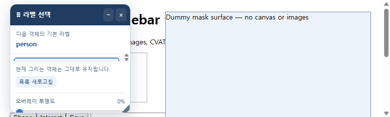
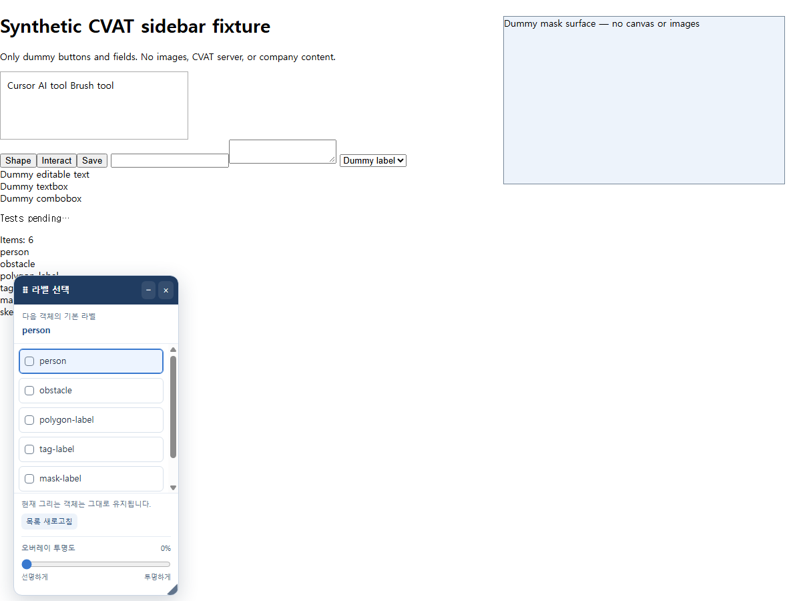

# CVAT Sidebar Shortcuts 2.1.4 QA 보고서

## 결과

**기존 회귀검사 443개는 모두 통과했지만, 추가 탐색 검사 15개 중 6개가 실패했습니다.** 새로 확인한 문제 4건, 이미 보류된 N 충돌 1건, 실제 CVAT 화면 구조를 추가 확인해야 하는 조건부 문제 1건입니다. 기능 수정과 버전 변경은 하지 않았습니다.

- 점검일: 2026-10-12, 한국 시간
- 점검 대상: `2.1.4`, 커밋 `3afc18ee590b61e08d7de3defa3c3be199553bf0`
- 실행 환경: Windows, 별도 Headless Chrome `154.0.8037.98`
- 방법: 소스 검토, 기존 전체 자동검사, 실제 Chrome 마우스 입력, 작은 화면·요소 전체화면, 저장 실패·동시 저장 재현, 배포 ZIP 대조
- 총 실행: **458개 — 452개 통과 / 6개 실패**. 패키지·로컬 문서 링크 확인은 이 숫자와 별도입니다.
- 범위: 예시 CVAT DOM·상태와 모의 Chrome 확장 API. 실제 회사 페이지·이미지·주석·사용자 브라우저 프로필에 접근하지 않았습니다.

## 발견 사항 요약

P2는 특정 사용 조건에서 기능이 잘못 동작해 수정이 필요한 문제, P3는 오류 상황의 복구·설정 처리 문제입니다. 실제 사용자 환경에서의 발생 빈도는 측정하지 않았습니다.

| ID | 분류 | 우선순위 | 문제 | 재현 조건 |
| --- | --- | --- | --- | --- |
| QA-01 / E07 | 신규 확인 | P2 | 다른 곳에서 바꾼 단축키가 이전 값으로 덮어써짐 | 설정 읽기와 저장 사이에 다른 컨텍스트의 변경이 들어오는 순서를 모의 |
| QA-02 / E05 | 신규 확인 | P2 | 작은 화면에서 라벨 목록이 사실상 보이지 않음 | 보이는 화면 높이 240 CSS px |
| QA-03 / E15 | 신규 확인 | P2 | 요소 전체화면에서 실패 안내 메시지가 보이지 않음 | `body`의 자식 요소를 전체화면으로 만든 뒤 안내 발생 |
| QA-04 / E06 | 신규 확인 | P3 | 꺼둔 오버레이가 설정 읽기 오류 후 다시 표시됨 | 위치 설정 읽기만 실패하도록 오류 주입 |
| QA-05 / E08 | 기존 보류 | P2 | N으로 완료하려 하면 AI 도구를 다시 실행함 | 확장 AI 단축키를 N으로 지정 |
| QA-06 / E10 | 조건부 재현 | 추가 확인 | Labels/Overview 원본 DOM이 사라지면 목록도 사라짐 | 같은 Job에서 원본 라벨 DOM 제거; 실제 CVAT의 탭 전환 동작은 미검증 |

### QA-01 — 동시에 저장하면 다른 설정이 이전 값으로 돌아감

**재현 순서**

1. AI 단축키가 V인 상태에서 팝업의 Space 이동 옵션을 끕니다.
2. 이 저장 작업이 기존 설정을 읽은 뒤 반환받기까지의 응답을 잠시 지연합니다.
3. 다른 컨텍스트에서 같은 설정의 AI 단축키를 Q로 바꾼 상황을 모의합니다.
4. 먼저 시작한 Space 옵션 저장을 계속 진행합니다.

**기대:** Space 이동은 꺼지고, 새 AI 단축키 Q는 유지되어야 합니다.

**실제:** Space 이동은 꺼지지만 AI 단축키가 **Q → V로 되돌아갔습니다.** 모의 저장 API로 동시 실행 순서를 고정한 재현입니다. 실제 Chrome 저장 서버에서의 충돌 빈도는 측정하지 않았습니다.

**원인:** 팝업이 기존 공통 설정 객체를 읽은 뒤, 자신이 바꾸는 필드 외의 값까지 포함해 전체 객체를 다시 저장합니다. `saving` 플래그는 해당 팝업 안에서만 유효하며 다른 창·탭의 저장까지 묶지 않습니다. 읽기 응답을 기다리는 동안 도착한 `storage.onChanged`도 이미 진행 중인 저장의 옛 스냅샷을 무효화하지 않습니다.

- 근거: [popup.js의 Space 설정 저장](../../extension/popup.js#L163), [휠 설정 저장](../../extension/popup.js#L176), [E07 재현 결과](exploratory-results.json)
- 영향: 단축키·기본 라벨·휠 옵션 등 같은 저장 객체를 공유하는 설정이 이전 값으로 돌아갈 수 있습니다. 이미지·주석 손실은 재현하지 않았습니다.
- 임시 대응: 여러 창·활성 탭에서 설정을 동시에 바꾸지 않고, 변경 후 팝업을 다시 열어 확인합니다.
- 수정 방향: 바뀌는 필드별 저장을 검토하거나, 모든 쓰기를 한 경로에서 순서대로 처리합니다. `get()`을 한 번 더 호출하는 것만으로는 원자성이 보장되지 않습니다.

### QA-02 — 화면 안에는 들어오지만 라벨을 고를 공간이 사라짐

**재현 순서:** 라벨 6개가 있는 선택창을 열고, 보이는 화면 크기를 800×240 CSS px로 줄입니다. 큰 확대 배율에서도 유사한 작은 표시 영역이 생길 수 있지만 이번 재현은 viewport 크기를 직접 조절했습니다.

**기대:** 화면에 들어오는 것과 함께 최소 한 행 이상의 라벨을 보고 스크롤·선택할 수 있어야 합니다.

**실제:** 선택창 높이는 224px로 화면 안에 들어왔지만, 목록의 `clientHeight`가 **14px**만 남았습니다. 위아래 패딩이 각각 7px이므로 라벨 내용에 쓸 높이가 사실상 없습니다. 안내·투명도 영역이 대부분의 공간을 차지합니다.

**원인:** 헤더·선택 라벨·푸터는 줄어들지 않고, 목록만 `min-height:0`으로 계속 줄어듭니다. 바깥 창의 경계만 확인하는 현재 표시 검사는 내부 라벨 목록의 사용 가능 여부를 확인하지 않습니다.

- 근거: [overlay.js의 목록·푸터 레이아웃](../../extension/overlay.js#L33), [창 높이 보정](../../extension/overlay.js#L119), E05
- 임시 대응: 브라우저 창 높이를 늘리거나 확대 배율을 낮춥니다. 필요하면 확장 팝업의 라벨 선택을 이용합니다.
- 수정 방향: 좁은 높이에서는 푸터를 접거나 전체 본문을 스크롤하게 하고, 라벨 목록에 최소 가시 높이를 확보합니다.



### QA-03 — 요소 전체화면에서 오류 안내가 화면 밖에 남음

**재현 순서**

1. CVAT 예시 UI를 감싼 `body`의 자식 요소에 실제 `requestFullscreen()`을 실행합니다.
2. 현재 작업에 없는 라벨에 연결된 단축키를 눌러 실패 안내를 발생시킵니다.

**기대:** 오버레이와 마찬가지로 안내 메시지도 전체화면에서 보여야 합니다.

**실제:** 안내 DOM과 문구는 생성됐지만 **전체화면 요소 밖의 `document.body`에 추가**됐습니다. 화면 캡처에는 라벨 오버레이가 보이지만 실패 안내는 보이지 않습니다.

**원인:** 오버레이는 전체화면 요소 안으로 옮기지만, `notify()`는 항상 `document.body`에 메시지를 붙입니다. z-index가 높아도 요소 전체화면의 바깥 UI는 표시되지 않습니다. 일반 창 전체화면(F11)이나 문서 전체를 대상으로 한 전체화면과 구분해야 합니다.

- 근거: [content.js의 notify](../../extension/content.js#L59), [overlay.js의 전체화면 처리](../../extension/overlay.js#L162), E15
- 영향: 라벨 누락, 도구 전환 실패, N 연동 실패 시 사용자가 이유를 보지 못할 수 있습니다.
- 임시 대응: 요소 전체화면을 해제한 뒤 다시 실행해 안내를 확인합니다.
- 수정 방향: 메시지도 `document.fullscreenElement || document.body` 아래에 표시하고, 전체화면 전환 중 이미 열린 메시지의 위치도 관리합니다.



### QA-04 — 위치 설정 읽기 실패가 꺼짐 설정까지 무시함

**재현 순서:** `cvatLabelOverlayEnabled=false`를 저장한 상태에서 오버레이를 초기화하되, 위치·크기 저장값인 `cvatLabelOverlayV1` 읽기만 실패하도록 주입합니다. 켜짐·꺼짐 설정 읽기는 정상 응답합니다.

**기대:** 정상적으로 읽은 꺼짐 설정을 유지하거나, 상태를 확인하지 못하면 표시를 보류해야 합니다.

**실제:** 저장값은 `false`인데 오버레이 상태가 **`visible`**이 됐습니다.

**원인:** 두 읽기를 `Promise.all`로 묶어 하나가 실패하면 성공한 다른 읽기 결과도 적용하지 않습니다. 오류를 무시한 뒤 `ready=true`로 바꾸면서 초기값 `overlayEnabled=true`로 표시합니다.

- 근거: [overlay.js의 기본 상태](../../extension/overlay.js#L90), [초기 저장값 로드](../../extension/overlay.js#L335), E06
- 범위: 위치 설정 읽기만 실패하는 상황을 주입한 결과입니다. 모든 저장소 읽기가 실패하면 상위 확장 활성화 자체가 중단될 수 있어 같은 증상이라고 단정할 수 없습니다.
- 임시 대응: 설정 읽기가 정상화된 뒤 팝업에서 선택창 사용을 다시 끕니다.
- 수정 방향: 위치와 켜짐 상태를 독립적으로 처리하고, 켜짐 여부를 읽지 못했을 때의 기본 동작을 명시합니다.

### QA-05 — N 중복 지정 문제는 여전히 보류 상태

**재현:** 확장 AI 단축키를 N으로 지정하고 N으로 시작한 뒤, 완료하려고 다시 N을 누릅니다.

**실제:** 모의 CVAT 상태에서 **시작 2회 / 완료 0회 / Esc 2회**를 기록했습니다. 현재 코드가 확장 단축키를 먼저 처리해 다시 Esc와 도구 시작을 실행하기 때문입니다. 실제 배포 CVAT에서의 데이터 손실 여부까지 검증한 결과는 아닙니다.

- 근거: [content.js의 단축키 분기](../../extension/content.js#L414), [Esc 전달](../../extension/content.js#L442), E08
- 기존 검사에는 ‘확장에 지정한 N이 우선한다’는 현재 동작을 확인하는 항목이 있습니다. 따라서 기존 검사 통과와 ‘N으로 완료할 수 있다’는 것은 서로 다른 판정입니다.
- 사용자가 이전에 수정을 보류한 항목이므로 이번 QA에서도 수정하지 않았습니다.
- 임시 대응: 확장 도구 단축키를 V·B 등 다른 키로 지정하고 CVAT 기본 N과 겹치지 않게 사용합니다. 예시 키가 실제 CVAT 설정과 겹치는지도 확인해야 합니다.

### QA-06 — 라벨 원본 DOM이 사라지는 화면 구조에서 목록이 비워짐

**재현:** 라벨이 표시되는 상태에서 Job 주소는 유지하고 `.cvat-objects-sidebar-labels-list`를 DOM에서 제거합니다. Overview 표도 없는 조건입니다.

**실제:** 약 500ms 주기의 다음 갱신 후 라벨이 **6개 → 0개**가 되고 Labels 또는 Overview를 열라는 안내로 바뀝니다.

**원인:** 갱신할 때마다 현재 DOM에서 전체 목록을 다시 읽으며, 같은 Job에서 마지막으로 확인한 목록을 임시 유지하지 않습니다.

- 근거: [content.js의 오버레이 상태 공급](../../extension/content.js#L666), [overlay.js의 목록 교체](../../extension/overlay.js#L171), [common.js의 목록 읽기](../../extension/common.js#L132), E10
- **조건부 결과:** 이번에는 원본 DOM 제거를 직접 모의했습니다. 실제 CVAT 버전이 Labels → Objects 전환이나 Overview 닫기에서 해당 DOM을 제거하는지는 확인하지 않았습니다. 숨기기만 한다면 같은 결과가 나지 않을 수 있습니다.
- 확인 방법: 비기밀 예시 작업에서 라벨을 한 번 읽은 뒤 Labels/Overview를 닫고 오버레이가 유지되는지 확인합니다.
- 임시 대응: 라벨을 제공하는 Labels 탭을 열어 둡니다.
- 개선 방향: 같은 Job 안에서만 마지막 정상 목록을 임시 유지하되, Job 변경·라벨 편집 시의 무효화와 실제 사용 직전 검증을 함께 설계합니다.

## 통과한 검사

| 검사 영역 | 통과 / 전체 | 확인 범위 |
| --- | --- | --- |
| Windows 도구 실행 | 71 / 71 | 라벨 선택, 도구 준비, 취소·중복 입력, 입력 예외 |
| Windows 팝업 | 42 / 42 | 단축키·라벨·오버레이 설정과 오류 안내 |
| Windows 브러쉬 휠 | 33 / 33 | 수정키, 크기 범위, 휠 정규화, 입력 예외 |
| Mac 모의 팝업 | 8 / 8 | Option·Cmd 표시와 입력 |
| Mac 모의 도구 실행 | 71 / 71 | 플랫폼 정보·입력을 모의한 도구 실행 |
| Mac 모의 휠 | 33 / 33 | 수정키·휠 처리 |
| 키 충돌 | 23 / 23 | Mousetrap 계약, 이벤트 우선 처리·해제 |
| Space 이동 | 32 / 32 | 드래그·해제 순서, 포커스·작업 변경 |
| 라벨 단축키 | 20 / 20 | 지정 라벨 선택, 중복·사용 불가 처리 |
| 오버레이 | 45 / 45 | 이동·크기·최소화·닫기·투명도·입력 격리 |
| 기본 N 라벨 연동 | 38 / 38 | 기본 N의 라벨·이전 도구 상태 유지 |
| Node 라벨 로직 | 12 / 12 | 설정·라벨 로직 |
| Chrome 실행 환경 | 15 / 15 | MAIN/ISOLATED 전달, 확대·전체화면·경계 보정 |
| 추가 탐색 검사 | 9 / 15 | 아래 상세 결과 참조 |
| **합계** | **452 / 458** | 기존 443개 + 추가 15개 |

추가로 통과한 항목은 실제 마우스로 라벨 선택·창 이동(E01), 최소화 버튼 이동·복원(E02), 투명도 저장(E03), 라벨 1,000개 표시·스크롤·마지막 항목 선택(E04), 저장 실패 시 기존 값 유지(E09), 실제 가장자리 크기 조절(E11), 완전히 닫기(E12), 지원하지 않는 주소에서 숨김(E13), 라벨 이름을 HTML이 아닌 문자로 표시(E14)입니다. E04는 기능 확인이며 장시간 사용·프레임률·메모리 사용량을 평가한 성능 벤치마크는 아닙니다.

배포 검사는 **22개 ZIP 파일과 현재 확장 소스의 바이트 일치**, 저장된 SHA-256 일치, 팝업·가이드의 로컬 링크, 기존 권한 유지 여부를 확인했습니다. 런타임 JavaScript 문법과 기존 네트워크·이미지 API 정적 검사도 통과했습니다. 별도의 보안 인증이나 침투 테스트를 수행했다는 뜻은 아닙니다.

## 재현 실행과 증거

저장소 루트에서 실행합니다. Node.js, Python, Windows Chrome이 필요합니다. Chrome 설치 경로가 다르면 `CVAT_TEST_CHROME`을 지정합니다.

```powershell
node tests/run-tests.mjs
node tests/test-label-logic.cjs
node tests/run-world-tests.mjs
node tests/qa-2.1.4.mjs
```

마지막 명령은 현재 미해결 항목을 기대 동작과 비교하므로 **종료 코드 1이 예상됩니다.** 실패를 정상으로 바꾸어 숨기지 않았습니다. 추가 검사기는 기존 예시 화면·Mousetrap·N 상태 모의를 재사용하고 회사 데이터를 사용하지 않습니다.

- [추가 탐색 검사 코드](../../tests/qa-2.1.4.mjs)
- [추가 검사 결과 JSON](exploratory-results.json)
- [기존 브라우저 검사 스냅샷](test-results.json)
- [Node 라벨 검사 스냅샷](label-logic-results.json)
- [Chrome 실행 환경 검사 스냅샷](world-results.json)
- [패키지·링크 검사 결과](package-checks.json)

## 남은 검증과 수정 우선순위

먼저 **동시 저장 충돌 → 작은 화면에서 라벨 선택 가능 여부 → 전체화면 안내 표시 → 초기 설정 읽기 실패 처리** 순으로 수정하는 것을 권장합니다. N 중복 지정 처리는 기존 보류 결정을 유지합니다. QA-06은 대상 CVAT의 DOM 유지 방식을 확인한 뒤 수정 범위를 결정해야 합니다.

실제 설치 확장의 권한·스크립트 주입, 특정 CVAT 배포 버전, 실제 Mac, Chrome 최소 지원 버전 102, 실제 AI 서버 응답 지연, 장시간 사용, 다중 모니터·모든 배율 조합은 이번 검사로 검증하지 않았습니다. 정상 회귀검사 통과만으로 모든 환경에서 버그가 없다고 판단할 수는 없습니다.
