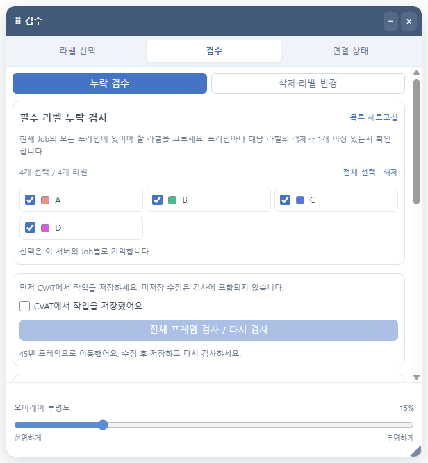
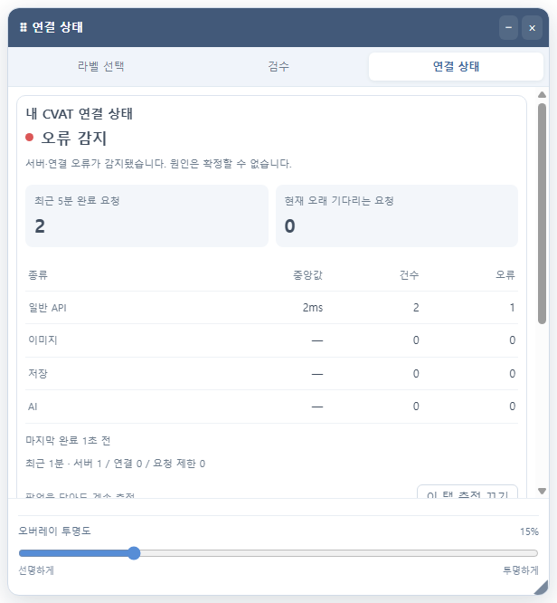

# 2.6.0 통합 작업 오버레이 검증

기존 라벨 선택 오버레이에 **라벨 선택 · 검수 · 연결 상태** 탭을 추가했습니다. 창을 여러 개 띄우지 않고 같은 창의 내용만 전환합니다. 창 위치·크기·투명도를 함께 사용하며, 각 화면의 스크롤 위치는 따로 유지합니다. 이동, 모든 가장자리 크기 조절, 최소화와 닫기 동작도 유지합니다.

확장 팝업의 검수·연결 상태 화면에는 작업 화면에서 해당 탭을 여는 버튼을 추가했습니다. 검수 결과·필수 라벨 설정과 연결 상태 통계·알림 설정은 기존 팝업과 공유합니다. 다른 Job으로 이동하면 이전 Job의 검수 화면을 초기화합니다.

## 검증 결과

| 검사 | 통과 |
| --- | ---: |
| DOM·팝업·기존 도구 회귀 검사 | 478 |
| 라벨 로직 | 12 |
| 연결 상태 로직·메시지 검증 | 48 |
| 검수 로직·API | 48 |
| Chrome MAIN·ISOLATED 통신 | 17 |
| Chrome 연결 상태 확장 통합 | 19 |
| Chrome 검수·작업 오버레이 확장 통합 | 30 |
| 릴리스·패키징 | 39 |
| **합계** | **691** |

실패 0개. 오버레이 화면 생성물·패치노트 생성물 일치 검사와 Git 공백 검사도 통과했습니다. 마지막 화면별 스크롤·탭 유지 보완 후에는 해당 Chrome 통합 검사 30개를 다시 실행했습니다. 위 숫자는 각 검사 묶음의 최신 성공 결과 합계입니다.

별도 Chrome 프로필과 localhost의 합성 CVAT 화면·데이터를 사용했습니다. 실제 Chrome 확장 팝업, 실행 환경 분리, Trusted Types CSP, 마우스·키보드 입력으로 다음을 확인했습니다.

- 팝업에서 검수·연결 상태 오버레이를 열고 화면을 전환합니다.
- 체크박스·버튼·선택 목록은 조작되며 해당 입력이 CVAT 단축키로 전달되지 않습니다.
- 필수 라벨 검사, 누락 결과, 현재 Job 프레임 이동과 팝업 설정 공유가 동작합니다.
- 다른 탭·프레임·Job으로 위장한 요청과 허용되지 않은 내부 동작은 거부합니다.
- 창의 위치·크기·투명도 유지, 넓이에 따른 라벨 목록 배치, 최소화 버튼 이동, 완전 닫기가 동작합니다.
- 연결 통계는 기존 요청만 집계하며, 창을 닫아도 켜진 측정은 유지됩니다. 숨겨진 화면의 통계 UI 갱신은 멈춥니다.

## 데이터·권한과 확인 범위

권한, 외부 전송, 능동 연결 확인 요청을 추가하지 않았습니다. 검수는 사용자가 선택한 Job의 저장된 주석을 기존 방식으로 조회합니다. 연결 상태는 기존 worker의 수동 관찰 통계를 사용합니다. 처음 사용하는 서버의 사이트 권한은 확장 팝업에서 허용해야 합니다.

사내 이미지·주석 및 개인 Chrome에는 접근하지 않았습니다. 실제 배포된 CVAT, 실제 사이트 권한 승인 창, 물리적인 Mac에서는 확인하지 않았습니다. 합성 화면의 성공을 실제 CVAT 최종 확인으로 간주하지 않습니다.

## 로컬 적용

1. CVAT에서 진행 중인 작업을 저장합니다.
2. `chrome://extensions`에서 `C:\git\cvat_shortcut\extension`으로 로드한 확장을 새로고침합니다.
3. CVAT 페이지도 새로고침하고, 확장 팝업에서 **이 탭에서 사용**을 누릅니다.
4. 작업 오버레이 상단의 **라벨 선택 / 검수 / 연결 상태** 탭으로 전환합니다. 팝업 안의 작업 화면에서 열기 버튼으로 바로 열 수도 있습니다.

스토어 업로드용 ZIP은 `releases/2.6.0/cvat-sidebar-shortcuts-2.6.0-ko.zip`입니다. 런타임 파일 35개와 SHA-256은 같은 폴더의 `build-audit.json`, 검사 요약은 `validation-2.6.0.json`에 기록했습니다. 이번 작업에서는 GitHub 푸시·스토어 제출을 실행하지 않았습니다.

## 합성 화면 캡처

